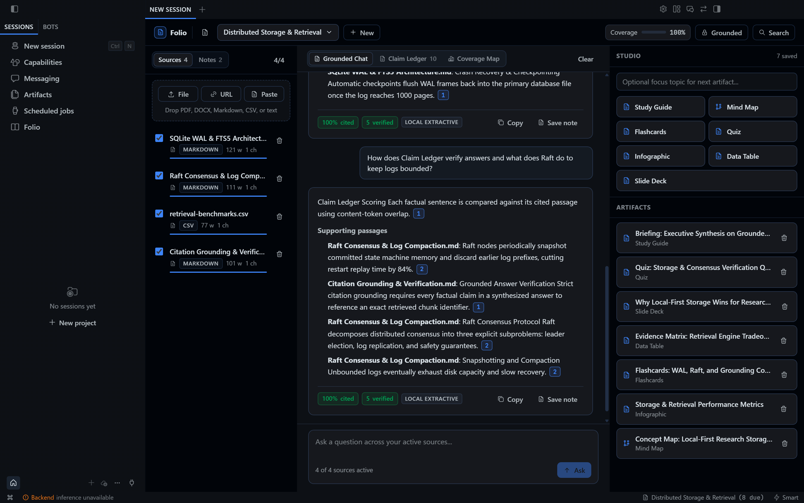
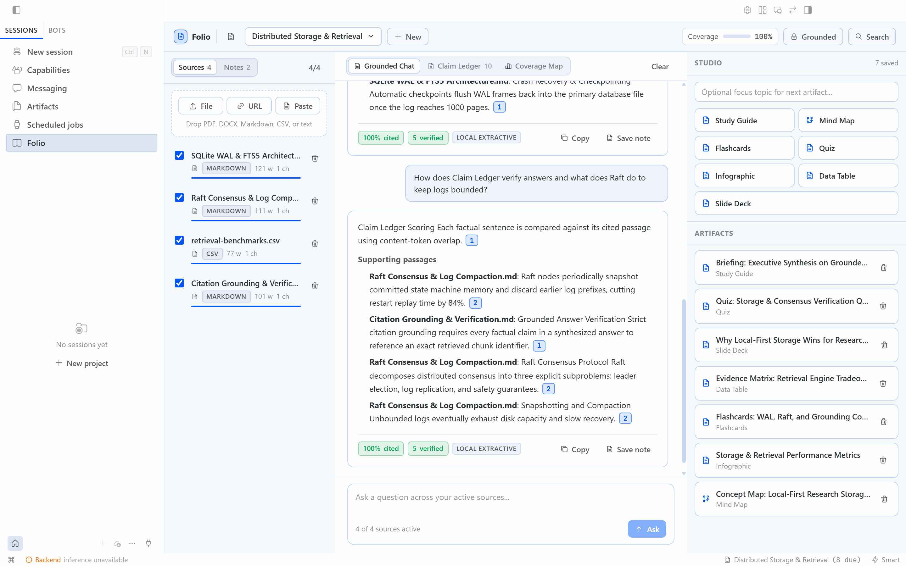
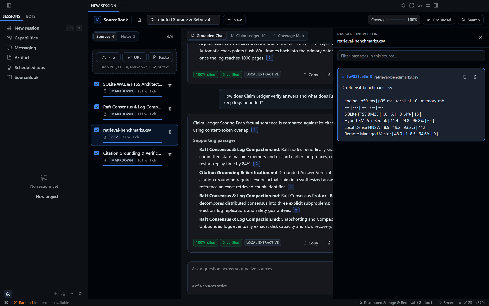
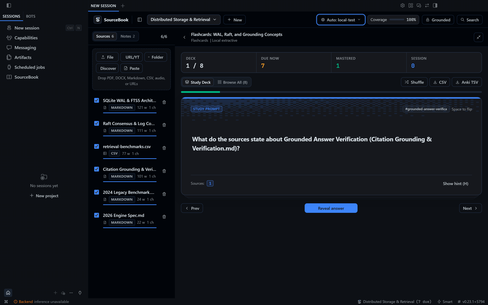
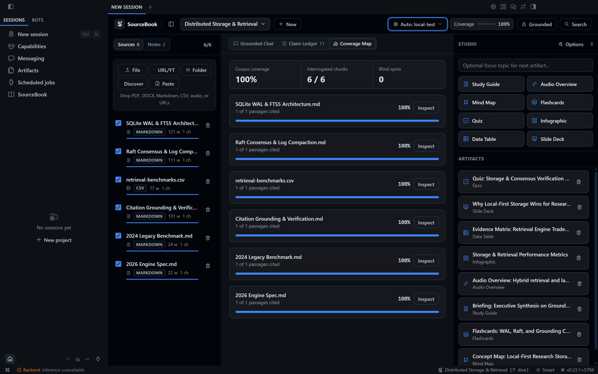
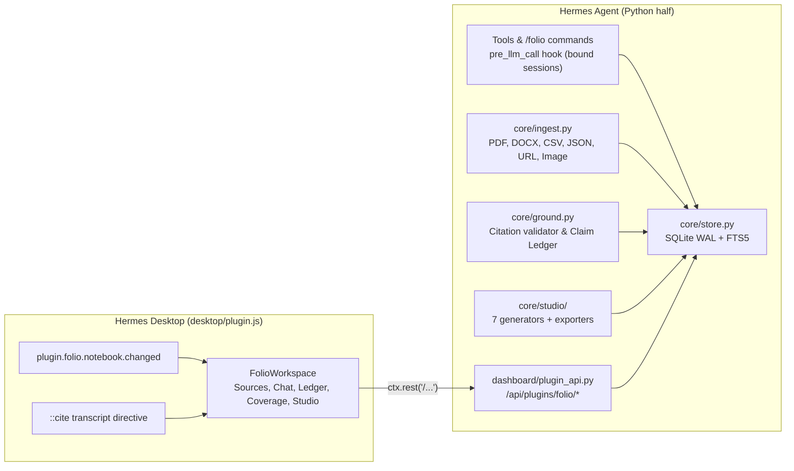

<h1 align="center">
  
</h1>

<p align="center">
  <b>Source-grounded research notebooks for Hermes Desktop.</b><br>
  Collect PDFs, DOCX files, Markdown, CSV tables, JSON, URLs, and notes in one local workspace.<br>
  Ask cited questions with a live Claim Ledger, track source coverage, and generate seven interactive Studio formats.
</p>

<p align="center">
  <a href="LICENSE"></a>
  <a href="#install"></a>
  <a href="#how-it-works"></a>
  <a href="#how-it-works"></a>
  <a href="#studio-formats"></a>
  <a href="https://github.com/abundantbeing"></a>
</p>

**Source-grounded research notebooks for Hermes.** Folio stores every notebook locally in SQLite WAL with FTS5 full-text indexing. Every answer cites exact source chunks with numbered marginalia pills, verifies each factual sentence in a Claim Ledger, measures how much of your corpus you have actually interrogated, and turns active sources into seven interactive Studio artifacts.



All screenshots show Folio running inside Hermes Desktop. Folio adopts your active Hermes theme automatically across both dark and light modes.



## What you get

- **Multi-format source ingestion.** Drag and drop PDF, DOCX (with a zero-dependency stdlib XML extractor when `python-docx` is absent), Markdown, plain text, CSV/TSV tables, JSON arrays, HTML, images (via Hermes vision), or web URLs (via Hermes `web_extract` with an SSRF-checked readability fallback). Toggle any source on or off per query.
- **Grounded chat with marginalia citations.** Every factual sentence carries numbered `[1]` `[2]` citation pills verified against the active chunk set. Any invented chunk ID is stripped before the reply is saved. Switch between Grounded and Strict mode at any time.
- **Passage Inspector.** Click any citation pill in Chat, Claim Ledger, Quiz explanations, Mind Map nodes, Data Tables, or Slides to open the exact chunk in context, filter within the source, copy text, or save an excerpt straight to Notes.
- **Claim Ledger.** Every assistant reply is audited sentence by sentence against its cited passages using token-overlap verification, classifying claims as `supported`, `partial`, or `unsupported` beside the matched source quote.
- **Coverage Map.** Tracks chunk hits across both chat and Studio runs so you can see which sources have been thoroughly interrogated and jump directly into unread blind spots.
- **Living Notes scratchpad.** Capture findings, save any chat reply as a Markdown note, detect when underlying sources change, and promote a note into an active source with one click.
- **Seven interactive Studio formats.** Generate Study Guides, pan/zoom Mind Maps, SM-2 Flashcards, interactive Quizzes, multi-layout Infographics, sortable Data Tables, and 16:9 Slide Decks, each with offline exports.
- **Works in chat everywhere.** Bind any Hermes session to a notebook with `/folio use <nb_id>` across Desktop, CLI, Telegram, Discord, or Slack. The `pre_llm_call` hook injects top retrieved excerpts only on bound sessions, and inline `::cite` directives jump straight into Folio's Passage Inspector.
- **Local extractive fallback.** When no external model provider is configured, Folio still answers questions and generates all seven Studio formats locally from your indexed FTS5 chunks, clearly labeled as `Local extractive`.

## Inside Folio

| Passage Inspector | Claim Ledger |
| --- | --- |
| [](docs/screenshots/passage-inspector.png) | [](docs/screenshots/claim-ledger.png) |

| Interactive Mind Map | Vector Infographic |
| --- | --- |
| [](docs/screenshots/studio-mindmap.png) | [](docs/screenshots/studio-infographic.png) |

| Sortable Data Table | 16:9 Slide Deck |
| --- | --- |
| [](docs/screenshots/studio-table.png) | [](docs/screenshots/studio-slides.png) |

| SM-2 Flashcards | Coverage Map |
| --- | --- |
| [](docs/screenshots/studio-flashcards.png) | [](docs/screenshots/coverage-map.png) |

Click any screenshot to inspect it at full size.

## Studio formats

| Format | Interactive viewer | Offline exports |
| --- | --- | --- |
| **Study Guide** | Structured Markdown reading view with clickable `[n]` citation pills | Markdown (`.md`) |
| **Mind Map** | Pan and zoom SVG canvas, collapsible branches, node summary and citations | Standalone SVG (Copy / `.svg`), OPML (`.opml`), Markdown |
| **Flashcards** | Flip cards with keyboard shortcuts, hints, shuffle, and persisted SM-2 grading | CSV (`.csv`), Anki TSV (`.tsv`), Markdown |
| **Quiz** | Mixed MCQ, True/False, and short-answer with cited rationales and Missed-only retry | Markdown answer key (`.md`), JSON |
| **Infographic** | Six layouts (`stat-grid`, `timeline`, `process`, `comparison`, `hub-spoke`, `pyramid`) | Standalone SVG (Copy / `.svg`), JSON |
| **Data Table** | Live row search, typed column sorting, and per-row citation chips | CSV (`.csv`), Markdown table |
| **Slide Deck** | 16:9 stage with assertion headlines, stat callouts, speaker notes, and filmstrip | Marp Markdown (`.marp.md`), self-contained HTML deck (`.deck.html`) |

Both Mind Map and Infographic resolve CSS theme variables (including `color-mix()`) to concrete sRGB colors before copying or downloading SVG, so exported diagrams render identically outside Hermes Desktop.

## Install

Requires Hermes Agent and Hermes Desktop **0.22.6 or newer**.

```bash
hermes plugins install abundantbeing/folio --enable
```

Then, in Hermes Desktop:

1. Open **Capabilities, Plugins** and click **Rescan** if Folio is not listed yet.
2. Confirm **Agent** is enabled for tools, hooks, auxiliary model slots, and `/folio` commands.
3. Enable **Desktop** to mount the Folio sidebar entry, workspace route, command palette command, status chip, and Settings page.

Optional Python dependency for PDF extraction:

```bash
uv pip install pypdf
```

DOCX, CSV, JSON, Markdown, HTML, plain text, and URL ingestion work with zero extra Python packages.

## Using it

### In Hermes Desktop

- Open **Folio** from the left sidebar or press `Ctrl+K` / `Cmd+K` in the command palette and run **Folio: Open research notebooks**.
- Press `Ctrl+K` / `Cmd+K` inside Folio to search across every notebook in your active profile.
- Configure dedicated auxiliary models for `folio_chat`, `folio_studio`, and `folio_ingest` in **Settings, Models, Auxiliary**.

### Slash commands (Desktop, CLI, Telegram, Discord, Slack)

| Command | Action |
| --- | --- |
| `/folio list` | List notebooks with IDs and source counts |
| `/folio use <nb_id>` | Bind the current chat session to a notebook |
| `/folio unuse` | Unbind the current chat session |
| `/folio status` | Show the active notebook binding |
| `/folio add <nb_id> <url or text>` | Ingest a URL or text note into a notebook |
| `/folio ask <nb_id> <question>` | Ask a grounded question with verified citations |
| `/folio make <nb_id> <kind> [focus]` | Generate a Studio artifact (`report`, `mindmap`, `flashcards`, `quiz`, `table`, `infographic`, `slides`) |

### Agent tools

| Tool | Purpose |
| --- | --- |
| `folio_list_notebooks` | List available Folio notebooks |
| `folio_search` | Run BM25 full-text search across active chunks in a notebook |
| `folio_save_note` | Save a cited Markdown research note into a notebook |
| `folio_studio` | Generate any of the seven Studio artifact formats |

## How it works



## Development

```bash
npm install
npm run check
hermes plugins validate . --install-deps
```

`desktop-src/` holds the modular JSX source bundled into `desktop/plugin.js` via `esbuild` with only `@hermes/plugin-sdk`, `react`, and `react/jsx-runtime` kept external.

## Privacy and disclosure

- **Local storage only.** Notebooks, extracted text, SQLite FTS5 indexes, notes, chat transcripts, and Studio artifacts stay on your machine under `<hermes home>/plugin-data/folio/`, resolved dynamically per Hermes profile.
- **No telemetry, no external services, no binaries, no self-update.** Outbound model calls happen only through Hermes's configured LLM router (`ctx.llm`) with Hermes secret redaction applied to source chunks before prompting.
- **URL safety.** Web ingestion uses Hermes's `web_extract` tool when available and validates URLs against SSRF rules before any HTTP request.
- **Documented SDK surface only.** The Desktop half imports only `@hermes/plugin-sdk`, `react`, and `react/jsx-runtime`, communicates with its own backend exclusively via `ctx.rest`, scopes state by profile, connection, and gateway activation epoch, and never patches app markup or internal stores.
