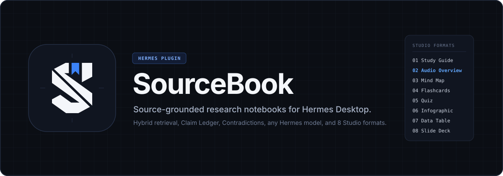
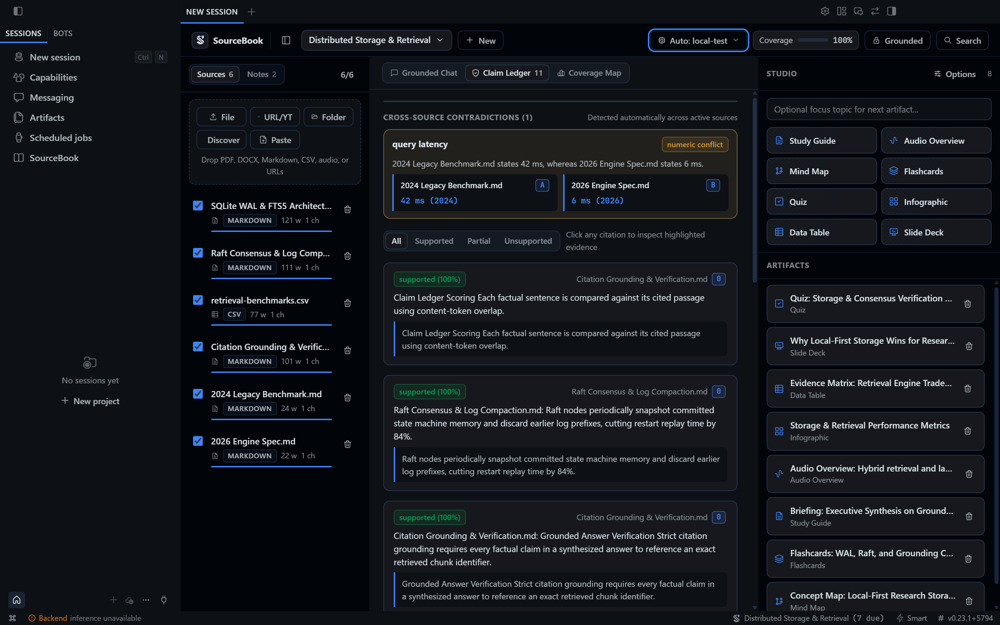
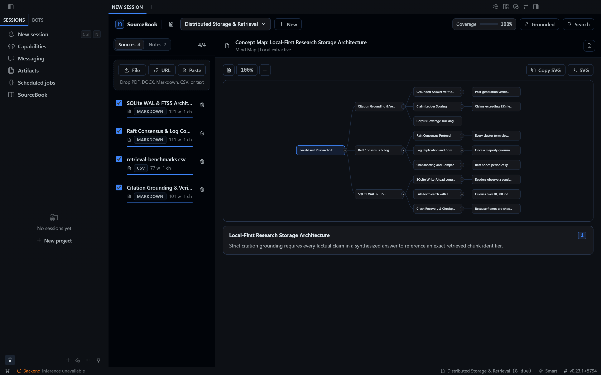
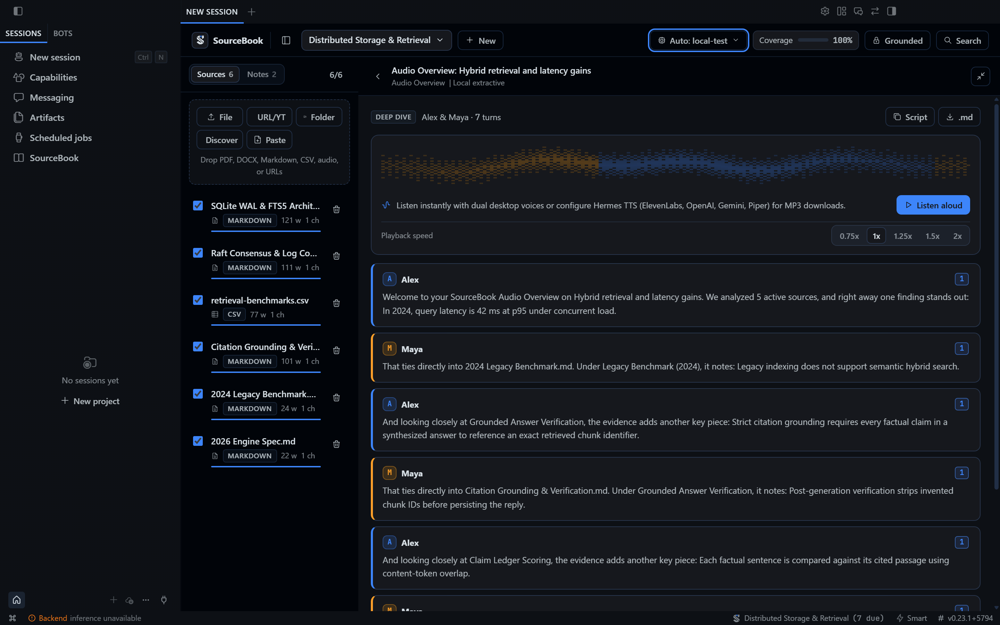
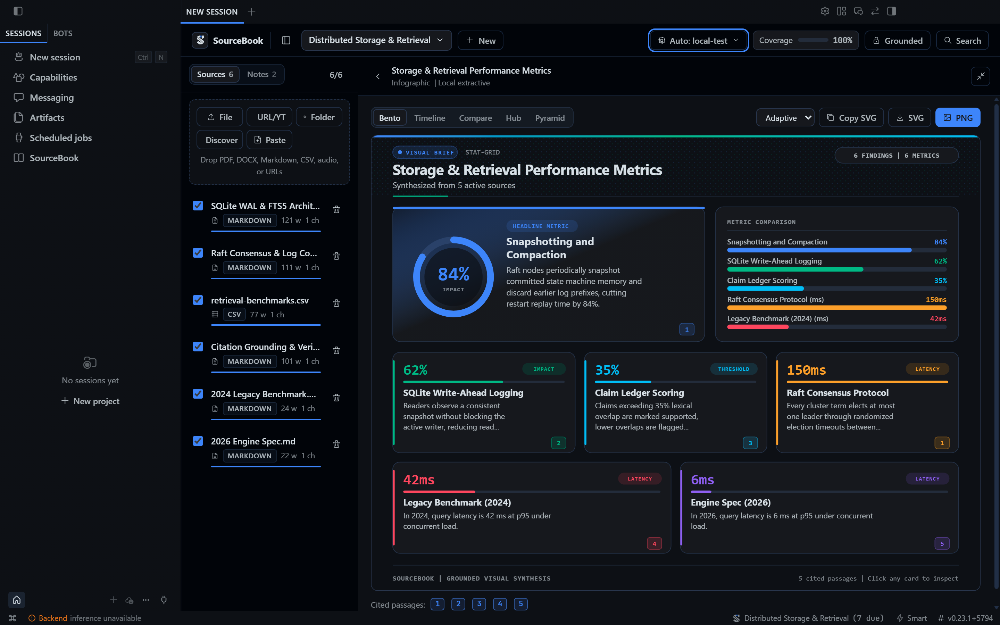
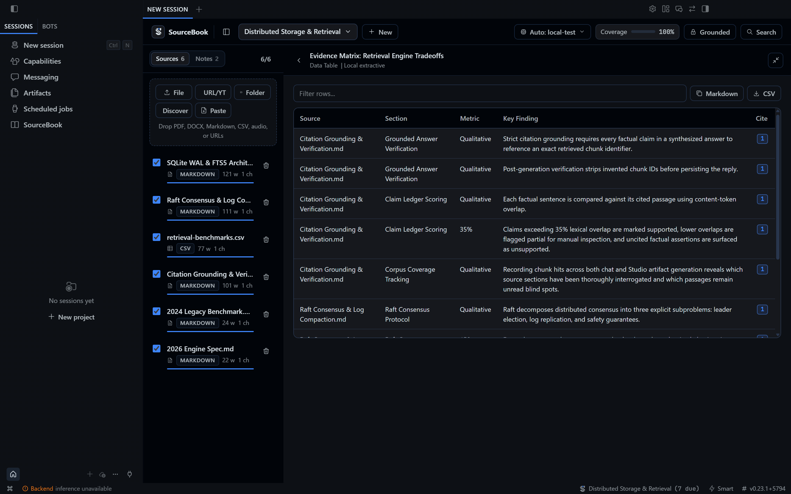
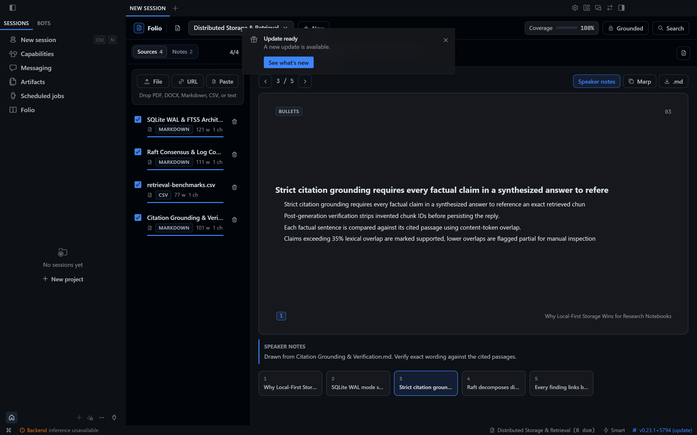
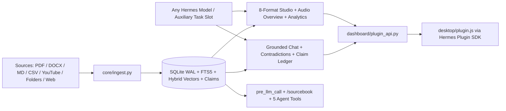

<h1 align="center">
  
</h1>

<p align="center">
  <b>Source-grounded research notebooks for Hermes Desktop.</b><br>
  Collect PDFs, DOCX files, Markdown, CSV tables, JSON, YouTube transcripts, local folders, and web URLs in one local workspace.<br>
  Run on any model configured in Hermes, audit claims and cross-source contradictions, and generate eight interactive Studio formats including 2-host Audio Overviews.
</p>

<p align="center">
  <a href="LICENSE"></a>
  <a href="#install"></a>
  <a href="#how-it-works"></a>
  <a href="#how-it-works"></a>
  <a href="#studio-formats"></a>
  <a href="https://github.com/abundantbeing"></a>
</p>

**Source-grounded research notebooks for Hermes.** SourceBook stores every notebook locally in SQLite WAL with hybrid semantic vector + FTS5 BM25 retrieval. Every answer cites exact source passages with numbered marginalia pills, verifies factual claims and cross-source contradictions in a live Claim Ledger, tracks corpus coverage, works with any model provider configured in Hermes, and turns active sources into eight interactive Studio formats.


All screenshots show SourceBook running inside Hermes Desktop. SourceBook adopts your active Hermes theme automatically across both dark and light modes.


## What you get

- **Works with any Hermes model.** Route notebooks automatically through your active Hermes model, assign dedicated Hermes auxiliary task slots (`sourcebook_chat`, `sourcebook_studio`, `sourcebook_audio`, `sourcebook_ingest`), or pick any configured provider and model per notebook right from the topbar. A 3-tier JSON compatibility ladder (`json_schema`, `json_mode`, and plain text JSON extraction) keeps structured Studio generation reliable across OpenAI, Anthropic, Gemini, Codex, OpenRouter, Ollama, LM Studio, DeepSeek, and custom endpoints.
- **Hybrid semantic + BM25 retrieval.** Combines SQLite FTS5 BM25 keyword ranking with local semantic vectors via Reciprocal Rank Fusion (RRF), matching paraphrases and conceptual queries without requiring an external embedding service.
- **Multi-format ingestion, YouTube, local folders, and Web Discovery.** Drag and drop PDF (with PyMuPDF/pdfplumber/pypdf and automatic vision OCR on scanned pages), DOCX (stdlib XML fallback included), Markdown, code, CSV/TSV, JSON, HTML, audio/video, images, or web and YouTube URLs (timestamped transcripts with video jump links). Sync local folders, Obsidian vaults, or Git repos directly from disk, refresh linked files or URLs in place, or use **Discover** to search the web and bulk-import candidate sources.
- **Grounded chat with rich Markdown, personas, and marginalia citations.** Renders fenced code blocks with copy buttons, GFM tables, blockquotes, ordered lists, and numbered `[1]` `[2]` citation pills. Switch personas (`Default`, `Analyst`, `Critic`, `Tutor`, `Socratic`), answer length (`Short`, `Standard`, `Deep`), and `Grounded` vs `Strict` mode directly in the composer.
- **Claim Ledger & Cross-Source Contradictions.** Audits every assistant sentence with stemmed semantic + numeric alignment (explicitly flagging number mismatches) and scans active sources automatically to surface cross-source numeric and polarity contradictions side by side.
- **Passage Inspector & Tabular Data Analyzer.** Click any citation pill to inspect highlighted evidence in context, jump straight to YouTube timestamps, or click **Analyze data** on CSV/JSON sources to compute exact column statistics (`min`, `max`, `mean`, `median`, `p95`, `sum`) and inline bar charts.
- **Coverage Map & Living Notes.** Tracks chunk hits across chat and Studio runs to highlight unread blind spots. Refreshing a linked file or URL automatically marks affected Living Notes and Studio Artifacts as `Stale` with one-click refresh.
- **Eight interactive Studio formats.** Study Guides (6 templates), 2-Host Audio Overviews (neural MP3 synthesis + synchronized cited transcript + interactive **Ask Hosts** follow-up), pan/zoom Mind Maps, SM-2 Flashcards, Quizzes, multi-layout Infographics, sortable Data Tables, and 16:9 Slide Decks with Presenter Mode.
- **Works in chat everywhere.** Bind any Hermes session with `/sourcebook use <nb_id>` across Desktop, CLI, Telegram, Discord, or Slack, pin models with `/sourcebook model`, or sync folders with `/sourcebook sync`.
- **Local extractive fallback.** When no external model provider is configured, SourceBook still answers questions and generates all eight Studio formats locally from your indexed chunks, labeled clearly as `Local extractive`.

## Inside SourceBook

| Passage Inspector | Claim Ledger & Contradictions |
| --- | --- |
| [](docs/screenshots/passage-inspector.png) | [](docs/screenshots/claim-ledger.png) |

| Interactive Mind Map | Audio Overview (2-Host Podcast) |
| --- | --- |
| [](docs/screenshots/studio-mindmap.png) | [](docs/screenshots/studio-audio.png) |

| Vector Infographic | Sortable Data Table |
| --- | --- |
| [](docs/screenshots/studio-infographic.png) | [](docs/screenshots/studio-table.png) |

| 16:9 Slide Deck & Presenter Mode | SM-2 Flashcards |
| --- | --- |
| [](docs/screenshots/studio-slides.png) | [](docs/screenshots/studio-flashcards.png) |

| Coverage Map | |
| --- | --- |
| [](docs/screenshots/coverage-map.png) | |

Click any screenshot to inspect it at full size.

## Studio formats

| Format | Interactive viewer | Offline exports |
| --- | --- | --- |
| **Study Guide** | Rich Markdown view (code blocks, tables, blockquotes, `[n]` pills) across 6 templates | Markdown (`.md`) |
| **Audio Overview** | 2-host neural podcast player (`0.75x`-`2x`), cited transcript, and **Ask Hosts** follow-up | MP3 audio (`.mp3`), Script (`.md`) |
| **Mind Map** | Pan and zoom SVG canvas, collapsible branches, node summary and citations | Standalone SVG (`.svg`), OPML (`.opml`), Markdown |
| **Flashcards** | Flip cards with keyboard shortcuts, hints, shuffle, and persisted SM-2 grading | CSV (`.csv`), Anki TSV (`.tsv`), Markdown |
| **Quiz** | Mixed MCQ, True/False, and short-answer with cited rationales and Missed-only retry | Answer Key (`.md`), JSON |
| **Infographic** | Six layouts (`stat-grid`, `timeline`, `process`, `comparison`, `hub-spoke`, `pyramid`) + optional AI hero visual | Standalone SVG (`.svg`), JSON |
| **Data Table** | Live row search, typed column sorting, and per-row citation chips | CSV (`.csv`), Markdown table |
| **Slide Deck** | 16:9 stage with assertion headlines, stat callouts, AI visuals, speaker notes, and Presenter Mode | Marp Markdown (`.marp.md`), Offline HTML Deck (`.deck.html`) |

Both Mind Map and Infographic resolve CSS theme variables (including `color-mix()`) to concrete sRGB colors before copying or downloading SVG, so exported diagrams render identically outside Hermes Desktop.

## Install

Requires Hermes Agent and Hermes Desktop **0.22.6 or newer**.

```bash
hermes plugins install abundantbeing/sourcebook --enable
```

Optional extras for PDFs, scanned-PDF OCR, YouTube transcripts, and 2-host neural podcast audio:

```bash
uv pip install pymupdf youtube-transcript-api edge-tts
```

### Use any Hermes model per notebook

SourceBook runs automatically on your active Hermes model or your configured Hermes auxiliary task slots (`sourcebook_chat`, `sourcebook_studio`, `sourcebook_audio`, `sourcebook_ingest`). To enable per-notebook provider and model overrides directly from SourceBook's topbar picker, allow overrides in your Hermes config:

```bash
hermes config set plugins.entries.sourcebook.llm.allow_model_override true
hermes config set plugins.entries.sourcebook.llm.allow_provider_override true
```

## Slash commands & agent tools

Use SourceBook inside any Hermes chat (Desktop, CLI, Telegram, Discord, or Slack):

```text
/sourcebook list
/sourcebook use <nb_id>
/sourcebook model <nb_id> <provider/model|auto>
/sourcebook sync <nb_id> <local_path>
/sourcebook add <nb_id> <url or text>
/sourcebook ask <nb_id> <question>
/sourcebook make <nb_id> <kind> [focus]
/sourcebook unuse
```

Registered Hermes agent tools:

- `sourcebook_list_notebooks`: list notebooks, active models, and source counts
- `sourcebook_search`: hybrid semantic + BM25 search returning ranked chunks and citation IDs
- `sourcebook_save_note`: save a cited Markdown note into a notebook
- `sourcebook_studio`: generate any of the eight Studio formats (`report`, `audio`, `mindmap`, `flashcards`, `quiz`, `table`, `infographic`, `slides`)
- `sourcebook_analyze_data`: compute exact column profiles and chart series for CSV, TSV, JSON, or Markdown tables

## How it works



- **Local storage:** Every notebook lives inside `<HERMES_HOME>/plugin-data/sourcebook/notebooks/<nb_id>/` using SQLite WAL mode with FTS5 full-text search, local semantic vectors, and structured claim indexing, resolved dynamically so multi-profile gateways stay isolated.
- **Safe outbound handling:** Every passage passed to a model runs through `agent.redact`, URL ingestion validates addresses against `tools.url_safety`, and local path syncing checks `agent.file_safety`.
- **SDK boundary:** The Desktop bundle imports strictly `@hermes/plugin-sdk`, `react`, and `react/jsx-runtime`, using native Hermes theme variables (`--ui-bg-chrome`, `--ui-bg-sidebar`, `--ui-bg-elevated`, `--ui-accent`).

## Development

```bash
npm install
npm run check
pytest tests/test_sourcebook.py -v
hermes plugins validate . --install-deps
```

## License

MIT. See [LICENSE](LICENSE).
